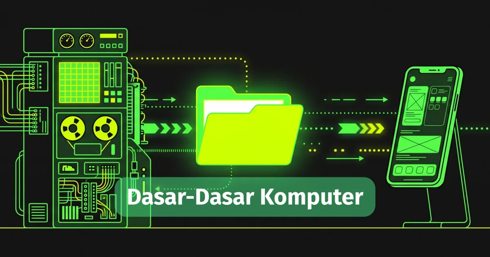

Selamat datang di panduan penulisan jurnal! Halaman ini berfungsi sebagai referensi (_cheatsheet_) sekaligus demonstrasi langsung bagaimana mesin Astro dan Tailwind CSS v4 merender elemen-elemen Markdown menjadi desain Neo-Brutalism yang garang.

## Pemformatan Teks Dasar

Anda dapat menggunakan sintaks Markdown standar untuk memberikan penekanan pada teks:

- **Teks Tebal (Bold):** Gunakan bintang ganda seperti **teks ini**.
- _Teks Miring (Italic):_ Gunakan bintang tunggal seperti _teks ini_.
- ~~Teks Coret (Strikethrough):~~ Gunakan tilde ganda seperti ~~teks ini~~.
- `Kode Sebaris (Inline Code)`: Gunakan _backtick_ tunggal untuk menyorot nama variabel atau perintah singkat.

> **Kutipan (Blockquote)**
> Ini adalah contoh blok kutipan. Sangat cocok digunakan untuk mengutip pernyataan penting, menyoroti peringatan, atau sekadar memberikan catatan tambahan di tengah artikel.

---

## Hierarki Judul (Headings)

Gunakan tanda pagar (`#`) untuk membuat struktur dokumen. (Catatan: Hindari penggunaan H1 `#` di dalam konten karena H1 sudah digunakan secara eksklusif untuk judul artikel utama di bagian atas halaman).

### Ini adalah Judul H3

#### Ini adalah Judul H4

##### Ini adalah Judul H5

---

## Daftar (Lists)

Daftar sangat penting untuk memecah informasi kompleks menjadi poin-poin yang mudah dibaca.

**Daftar Tidak Berurutan (Unordered List):**

- Kopi Hitam
- Papan Ketik Mekanis
- Monitor Ultrawide
  - Kabel HDMI (Sub-item)
  - Kabel DisplayPort (Sub-item)

**Daftar Berurutan (Ordered List):**

1. Siapkan secangkir kopi.
2. Buka Visual Studio Code.
3. Jalankan perintah `npm run dev`.
4. Mulai menulis kode tanpa henti.

---

## Blok Kode (Code Blocks)

Karena kita menggunakan integrasi Shiki bawaan Astro dengan tema `dracula`, Anda cukup menggunakan _backtick_ tiga kali diikuti nama bahasanya. Skrip CSS global kita akan secara otomatis membungkusnya dengan batas putih tebal dan bayangan neon.

```javascript
// Contoh fungsi JavaScript sederhana
function sapaPengembang(nama) {
  const pesan = `Halo, ${nama}! Selamat datang di zona Neo-Brutalism.`;
  console.log(pesan);
  return pesan;
}

sapaPengembang("Herdi");
```

```css
/* Contoh konfigurasi CSS Tailwind */
@theme {
  --color-neon: #c6ff00;
  --color-cyan: #00e5ff;
}
```

---

## Tabel Neo-Brutalism

Plugin `scripts/rehype-content-wrappers.mjs` membungkus tabel Markdown/MDX dengan `.table-scroll` pada tahap kompilasi konten. CSS di `global.css` menangani overflow horizontal, sementara elemen tabel native (`table`, `thead`, `tbody`, `th`, dan `td`) tetap dipertahankan. Tidak ada manipulasi DOM setelah halaman dimuat.

| Nama Properti | Tipe Data | Keterangan                                     | Status Wajib |
| :------------ | :-------: | :--------------------------------------------- | :----------: |
| `title`       |  String   | Judul utama artikel jurnal.                    |      Ya      |
| `pubDate`     |   Date    | Tanggal publikasi (Gunakan format ISO 8601).   |      Ya      |
| `coverImage`  | Asset | Path gambar sampul relatif terhadap file artikel.                          |    Tidak     |
| `coverImageAlt` | String | Alt text sampul yang menjelaskan isi visual.  |    Tidak     |
| `isDraft`     |  Boolean  | Jika `true`, artikel disembunyikan dari rilis. |      Ya      |

---

## Menyisipkan Gambar

Simpan gambar artikel di `src/assets/images/`, lalu gunakan path relatif dari file artikel. Astro akan menghasilkan beberapa ukuran WebP responsif saat build. Untuk gambar isi Markdown, gunakan sintaks `` dengan path relatif. Jangan memakai `/images/...` untuk aset baru yang ingin dioptimalkan. Folder `public/` hanya untuk aset yang memang membutuhkan URL publik tetap seperti favicon, icon aplikasi, atau file unduhan. Tulis alt text yang menjelaskan informasi visual yang benar-benar terlihat; jangan hanya menyalin judul artikel jika gambar berisi diagram, screenshot, atau bukti teknis yang lebih spesifik.



---

## Menyematkan Video YouTube (Lazy Load)

Ini adalah fitur spesial di blog ini. Jangan gunakan tag `<iframe>` bawaan YouTube karena akan memperlambat waktu muat ( _loading_ ) halaman secara drastis.

Sebagai gantinya, sisipkan elemen HTML `div` dengan kelas `youtube-defer` dan berikan ID video pada atribut `data-video`. Skrip khusus kita di `BlogLayout.astro` akan merendernya menjadi kotak bergaya Neo-Brutalism interaktif yang baru memuat video saat diklik.

_(Contoh: Jika URL videonya adalah `https://www.youtube.com/watch?v=dQw4w9WgXcQ`, maka ID-nya adalah `dQw4w9WgXcQ`)_.

<div class="youtube-defer" data-video="dQw4w9WgXcQ"></div>

---

## Metadata dan transparansi artikel

Contoh frontmatter untuk artikel:

```yaml
---
title: "Contoh Judul Artikel"
description: "Ringkasan singkat yang menjelaskan manfaat dan isi artikel."
pubDate: 2026-11-28
updatedDate: 2026-11-29 # opsional; isi hanya jika ada pembaruan substantif
coverImage: "../../assets/images/materi-dasar-komputer-pemula-smk.webp"
coverImageAlt: "Tangkapan layar editor yang menampilkan contoh kode Python."
tags: ["python", "pemrograman"]
isDraft: true
---
```

Pedoman:

- `description` harus menjadi ringkasan yang akurat, bukan daftar kata kunci.
- `coverImageAlt` disarankan ketika sampul mengandung informasi yang relevan. Jelaskan gambar secara spesifik.
- Gunakan `updatedDate` hanya jika isi diperbarui secara substantif. Jangan mengubah tanggal hanya untuk memberi kesan artikel baru.
- Jika tutorial diuji, sebutkan versi bahasa, framework, sistem operasi, atau lingkungan yang benar-benar digunakan di dalam artikel.
- Bedakan pengalaman pribadi, hasil pengujian, pendapat, dan fakta yang berasal dari sumber.
- Untuk klaim teknis yang penting, berikan tautan ke dokumentasi resmi atau sumber primer dengan teks tautan yang menjelaskan sumbernya.
- Jangan menulis bahwa kode telah diuji bila hanya disusun atau dibaca tanpa dijalankan.

## Prinsip kualitas editorial

Sebelum menerbitkan artikel, pastikan pembaca dapat memahami:

1. Siapa penulisnya dan konteks pengalamannya.
2. Apa tujuan artikel dan siapa pembacanya.
3. Bagaimana contoh, eksperimen, atau riset dilakukan jika relevan.
4. Referensi apa yang mendukung klaim faktual.
5. Batasan atau versi teknologi yang dapat memengaruhi hasil.

Neobrutalism adalah identitas visual, bukan pengganti bukti. Tampilan artikel harus membantu membaca dan memeriksa informasi, bukan menutupi sumber atau konteks.
